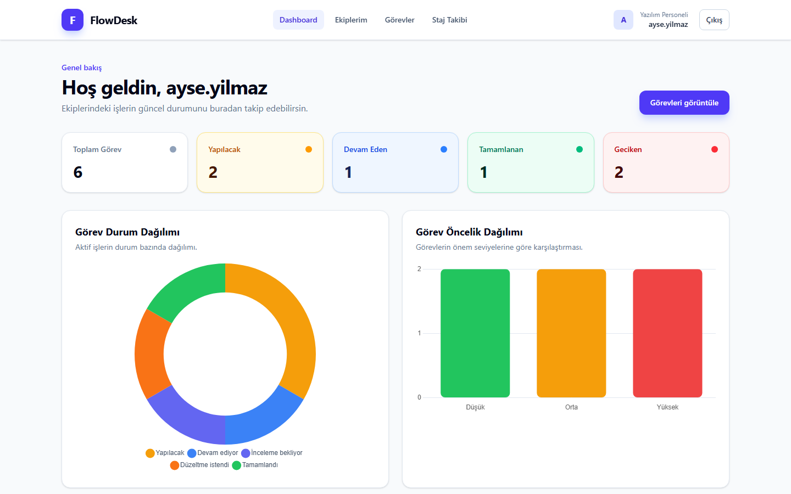
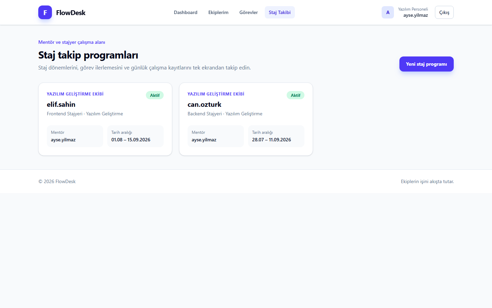
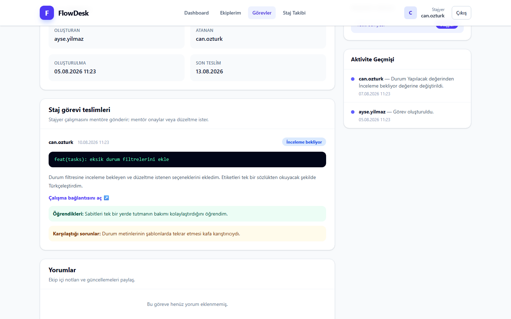
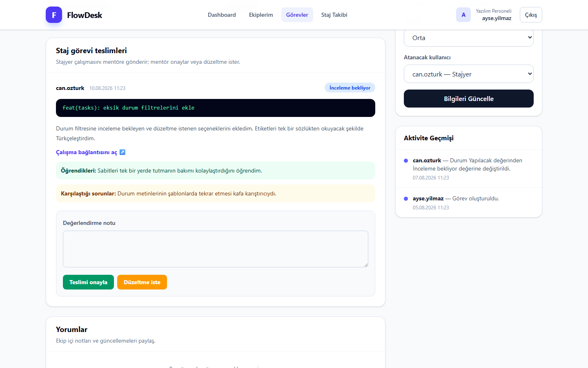
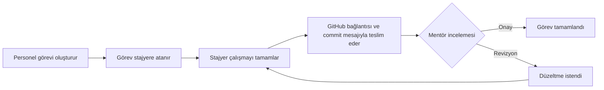

<div align="center">

# FlowDesk

**Yazılım ekipleri, mentörler ve stajyerler için görev ve staj takip platformu**

[](https://github.com/yunopo42/FlowDesk---Ekip_ve_Gorev_Yonetim_Sistemi/actions/workflows/tests.yml)


[](LICENSE)

</div>

FlowDesk, şirket içindeki yazılım ekiplerinin günlük görevlerini yönetirken aynı
ekiplere katılan stajyerlerin gelişimini de ayrı yetki sınırlarıyla takip etmeyi
sağlayan açık kaynaklı bir Flask uygulamasıdır. Personel ekip ve görevleri
yönetebilir; stajyer yalnızca kendisine atanan işi görür, GitHub bağlantısı ve
commit mesajıyla teslim eder. Mentör teslimi onaylayabilir veya açıklama yazarak
revizyon isteyebilir.

> [!NOTE]
> Proje eğitim ve portföy amacıyla geliştirilmiştir. Canlı şirket ortamına
> alınmadan önce README'deki [canlı ortam kontrol listesi](#canlı-ortam-kontrol-listesi)
> uygulanmalıdır.

## Ekran görüntüleri

| Personel dashboard'u | Staj ve mentör takibi |
| --- | --- |
|  |  |

| Stajyer görev teslimi | Mentör inceleme akışı |
| --- | --- |
|  |  |

## Öne çıkan özellikler

- Personel ve stajyer için birbirinden ayrılmış kayıt ve yetki modeli
- Ekip oluşturma, üye ekleme ve `Admin`, `Member`, `Intern` ekip rolleri
- Öncelik, son teslim tarihi, atanan kişi ve durum bilgisiyle görev yönetimi
- Stajyerin yalnızca kendisine atanan görevleri görüntüleyebilmesi
- GitHub/repo bağlantısı, commit mesajı ve çalışma özetiyle görev teslimi
- Mentörün teslimi onaylaması veya geri bildirimle revizyon istemesi
- Staj dönemi, şirket birimi, rol ve günlük çalışma kaydı takibi
- Dashboard metrikleri, geciken işler ve Chart.js grafikleri
- Profil fotoğrafı, telefon ve parola değiştirme işlemleri
- E-posta doğrulama ve süreli parola sıfırlama bağlantıları
- CSRF koruması, parola hashleme, güvenlik başlıkları ve istek sınırlama
- Türkçe, responsive Tailwind CSS arayüzü

## Roller ve yetkiler

| İşlem | Personel / Admin | Personel / Member | Stajyer |
| --- | :---: | :---: | :---: |
| Ekip oluşturma | ✅ | ✅ | ❌ |
| Ekibe üye ekleme ve rol yönetme | ✅ | ❌ | ❌ |
| Görev oluşturma | ✅ | ❌ | ❌ |
| Personel görevini yönetme | ✅ | Atanmışsa sınırlı | ❌ |
| Stajyer görevi teslim etme | ❌ | ❌ | Yalnızca kendi görevi |
| Stajyer teslimini inceleme | Mentör veya ekip admini | Mentörse | ❌ |
| Staj kaydı oluşturma | ✅ | ✅ | ❌ |
| Günlük çalışma kaydı gönderme | ❌ | ❌ | Yalnızca kendi stajı |

Personel bir **hesap türü**, mentörlük ise belirli bir staj kaydındaki
**ilişkidir**. Böylece bir personel bir veya daha fazla stajyere mentör olabilir;
stajyer de yazılım ekibine kısıtlı `Intern` rolüyle katılabilir.

## Görev teslim akışı



## Teknoloji yığını

| Katman | Teknoloji |
| --- | --- |
| Backend | Python 3.13, Flask 3.1 |
| ORM ve veritabanı | Flask-SQLAlchemy, SQLite; PostgreSQL uyumlu yapılandırma |
| Migration | Flask-Migrate / Alembic |
| Kimlik doğrulama | Flask-Login, Werkzeug parola hashleme |
| Form güvenliği | Flask-WTF / CSRFProtect |
| İstek sınırlama | Flask-Limiter |
| Görsel işleme | Pillow |
| Frontend | Jinja2, Tailwind CSS, Chart.js, vanilla JavaScript |
| Test | pytest |

FlowDesk JWT kullanmaz. Tarayıcı tabanlı bu uygulamada kimlik doğrulama,
Flask-Login tarafından yönetilen imzalı ve `HttpOnly` oturum çereziyle yapılır.
Parola değiştiğinde mevcut oturumları geçersiz kılmak için kullanıcı kimliğine
parola hash'inden türetilen kısa bir oturum imzası eklenir.

## Proje yapısı

```text
FlowDesk/
├── app/
│   ├── auth/           # Kayıt, giriş, doğrulama, profil ve parola işlemleri
│   ├── dashboard/      # Özet metrikler ve dashboard
│   ├── internships/    # Staj dönemleri ve günlük kayıtlar
│   ├── models/         # SQLAlchemy modelleri
│   ├── services/       # E-posta gönderim servisi
│   ├── tasks/          # Görev, teslim ve mentör inceleme akışları
│   ├── teams/          # Ekip ve üyelik yönetimi
│   ├── static/         # JavaScript ve yükleme dizini
│   └── templates/      # Jinja2 arayüz şablonları
├── migrations/         # Alembic veritabanı migration'ları
├── tests/              # pytest test paketi
├── docs/screenshots/   # README ekran görüntüleri
├── config.py           # Ortam değişkenleri ve uygulama ayarları
├── extensions.py       # Flask eklentileri
├── seed.py             # Tekrarlanabilir demo verisi
└── run.py              # Uygulama giriş noktası
```

## Yerel kurulum

### Gereksinimler

- Python 3.13 önerilir
- Git
- İsteğe bağlı: PostgreSQL veya Supabase bağlantısı

### Windows PowerShell

```powershell
git clone https://github.com/yunopo42/FlowDesk---Ekip_ve_Gorev_Yonetim_Sistemi.git
cd FlowDesk---Ekip_ve_Gorev_Yonetim_Sistemi

py -m venv .venv
.\.venv\Scripts\Activate.ps1
python -m pip install --upgrade pip
python -m pip install -r requirements.txt

Copy-Item .env.example .env
python -c "import secrets; print(secrets.token_hex(32))"
```

Son komutun ürettiği değeri `.env` içindeki `SECRET_KEY` alanına yazın. Ardından:

```powershell
python -m flask --app run.py db upgrade
python seed.py
python run.py
```

Uygulama varsayılan olarak <http://127.0.0.1:5000> adresinde açılır.

### Linux / macOS

```bash
git clone https://github.com/yunopo42/FlowDesk---Ekip_ve_Gorev_Yonetim_Sistemi.git
cd FlowDesk---Ekip_ve_Gorev_Yonetim_Sistemi

python3 -m venv .venv
source .venv/bin/activate
python -m pip install --upgrade pip
python -m pip install -r requirements.txt

cp .env.example .env
python -c "import secrets; print(secrets.token_hex(32))"
python -m flask --app run.py db upgrade
python seed.py
python run.py
```

## Demo hesapları

`python seed.py` mevcut kullanıcı verisini silmeden örnek ekip, görev, staj ve
teslim kayıtları ekler. Komut tekrar çalıştırılabilir.

| Rol | E-posta | Parola |
| --- | --- | --- |
| Yazılım personeli / ekip admini / mentör | `ayse.yilmaz@flowdesk.local` | `Flowdesk2026!` |
| Stajyer | `can.ozturk@flowdesk.local` | `Flowdesk2026!` |

> [!WARNING]
> Bunlar yalnızca yerel demo hesaplarıdır. İnternete açık bir kurulumda demo
> verisini kullanmayın veya parolaları hemen değiştirin.

Tüm yerel veriyi silip demoyu yeniden kurmak için `python seed.py --reset`
kullanılabilir. Bu komut onay ister ve mevcut kayıtları kalıcı olarak siler.

## Testler

Geliştirme bağımlılıklarını yükleyip tüm testleri çalıştırın:

```bash
python -m pip install -r requirements-dev.txt
python -m pytest
```

Test paketi; kimlik doğrulama, e-posta doğrulama, parola sıfırlama, profil,
ekipler, görevler, staj takibi, şablonlar, CSRF ve güvenlik başlıklarını kapsayan
84 test içerir. GitHub Actions her push ve pull request'te aynı paketi çalıştırır.

## Ortam değişkenleri

Tüm seçenekler ve açıklamaları [`.env.example`](.env.example) içinde bulunur.
Temel değişkenler:

| Değişken | Açıklama |
| --- | --- |
| `SECRET_KEY` | Oturum ve güvenlik token'larını imzalar; zorunludur |
| `DATABASE_URL` | Boşsa yerel SQLite, doluysa PostgreSQL bağlantısı kullanılır |
| `APP_BASE_URL` | E-posta bağlantılarında kullanılan uygulama adresidir |
| `MAIL_*` | SMTP sunucusu ve gönderen hesap ayarlarıdır |
| `RATELIMIT_STORAGE_URI` | Yerelde `memory://`, canlıda Redis önerilir |
| `COOKIE_SECURE` | HTTPS kullanılan canlı ortamda `true` olmalıdır |

## Canlı ortam kontrol listesi

- Güçlü ve benzersiz `SECRET_KEY`, doğrulama salt'ları ve SMTP parolası kullanın.
- `FLASK_DEBUG=false` ve `COOKIE_SECURE=true` ayarlayın.
- SQLite yerine yönetilen PostgreSQL, `memory://` yerine Redis kullanın.
- Uygulamayı Flask geliştirme sunucusu yerine WSGI sunucusu ve HTTPS ters vekili
  arkasında çalıştırın.
- Personel kayıtlarını davet veya yönetici onayına bağlayın.
- Demo hesaplarını ve demo verisini canlı veritabanına eklemeyin.
- Düzenli yedekleme, merkezi loglama ve hata izleme kurun.
- Bağımlılık ve güvenlik taramalarını CI sürecine ekleyin.

## Katkıda bulunma

Hata bildirimleri ve geliştirme önerileri memnuniyetle karşılanır. Geliştirme
ortamı, branch düzeni ve pull request adımları için
[CONTRIBUTING.md](CONTRIBUTING.md) dosyasına bakın. Güvenlik açığını herkese açık
issue olarak paylaşmadan önce [SECURITY.md](SECURITY.md) dosyasını okuyun.

## Lisans

Bu proje [MIT Lisansı](LICENSE) ile açık kaynak olarak sunulmaktadır.
